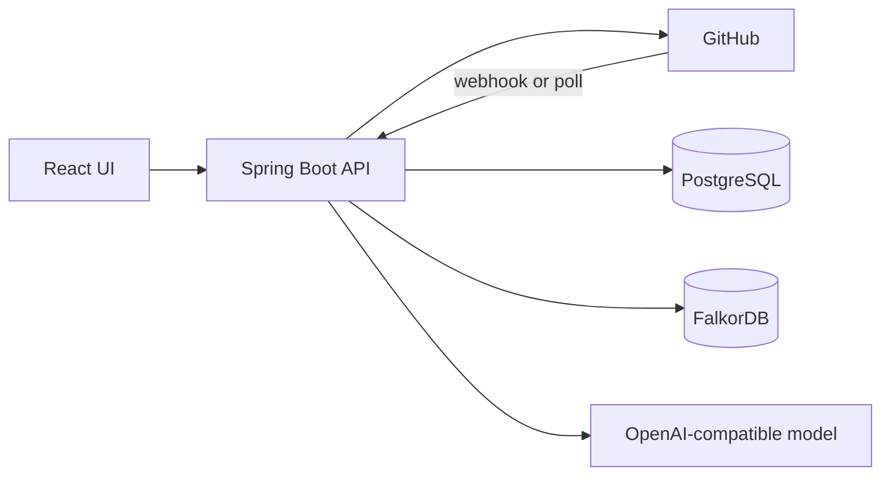
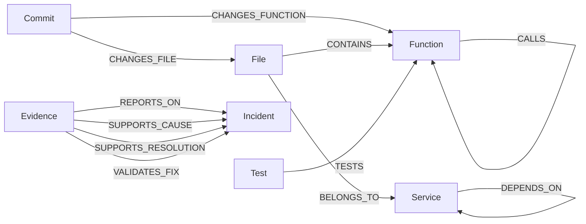
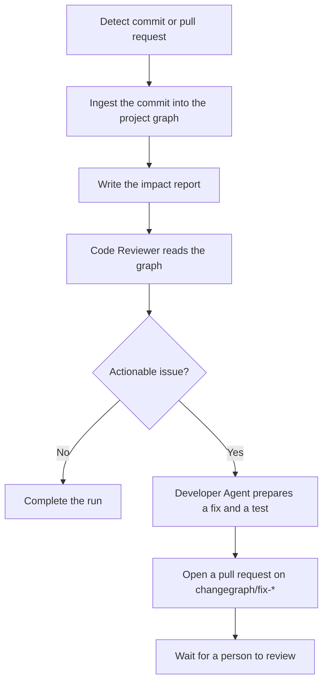

# ChangeGraph

ChangeGraph watches a public GitHub repository and explains what a change can break before it is merged.

Link a repository to a project. ChangeGraph builds a code graph for that project, then follows each new commit and pull request through ingestion, impact analysis, and review. When the review finds a breaking change, a high-impact service boundary, or a changed function with no direct test, a developer agent proposes a fix and a test on a separate branch and opens a pull request for a person to review.

## Architecture

The browser talks only to the ChangeGraph API. PostgreSQL holds accounts, projects, repository links, workflow history, and analysis reports. FalkorDB holds one code graph per project. GitHub is the source of commits, files, and pull requests.



In local development the UI is a Vite app on port 5173 and proxies `/api` to the API on port 1213. Docker Compose serves the built UI and the API on one origin, so the session cookie stays on that origin. Nginx proxies `/api` to the API, including the workflow event stream.

Each project graph is named `cg_` plus the project id with hyphens removed. The API checks project ownership on every project route. A missing or unowned project returns 404. PostgreSQL and FalkorDB are separate stores: project creation saves the graph name first, then initializes the graph. `graphStatus` is `READY` or `FAILED`. Retry uses the same stored name. Deleting a project requires confirmation in the UI and `confirm=true` on the API, and removes only the graph stored for that project.

### Graph data model

One FalkorDB graph per project. Every node is merged on `id`.

| Label | id | Properties |
| --- | --- | --- |
| Repository | GitHub repository id | `owner`, `name`, `url` |
| File | repository-relative path | `path`, `packageName`, `parseError`, `importSummary` |
| Function | `path#qualifiedSignature` | `name`, `signature`, `qualifiedSignature`, `filePath`, `className`, `isTest`, `startLine`, `endLine`, `unresolvedCallCount` |
| Service | qualified class or module name | `name`, `basis` |
| Test | same id as the test function | `name`, `filePath`, `signature` |
| Commit | commit sha | `sha`, `message`, `committedAt`, `limitations` |
| Incident | incident id | `title`, `summary`, `sourceType`, `isSynthetic`, `scenarioKey`, `updatedAt` |
| Evidence | evidence id | `evidenceType`, `verificationStatus`, `confidence`, `summary`, `sourceType`, `isSynthetic`, `functionId`, `updatedAt` |

`qualifiedSignature` is the qualified class or module, a `#`, and the signature, so a function id contains two `#` characters. `basis` is the annotation or decorator that marked the service (`Service`, `Component`, `Controller`, `RestController`, `Repository`, `Injectable`, `Module`, `Router`). `functionId` on Evidence is the Function id it refers to. It is a property, not an edge. `changeType` lives on the commit edges.



`DEPENDS_ON` is written when a resolved call leaves one annotated service for another. A test function that calls a non-test function also gets a `TESTS` edge. `CALLS` is written for other resolved calls.

### Cypher and the impact walk

FalkorDB runs a fixed set of queries. The application chooses the label and the relationship type. Property values are parameters.

Creating a project runs `RETURN 1 AS ok` on the new graph name, which creates that graph. Deleting a project calls `deleteGraph()` on that name only.

Ingestion merges one node at a time, then one edge at a time:

```cypher
MERGE (n:Function {id: $id})
SET n.name = $p0, n.signature = $p1, n.filePath = $p2, n.className = $p3, n.isTest = $p4
```

Repository, File, Service, Test, Commit, Incident, and Evidence use the same `MERGE` on `id`. Edges are merged after both endpoints exist:

```cypher
MATCH (a:Function {id: $from}), (b:Function {id: $to})
MERGE (a)-[:CALLS]->(b)

MATCH (a:Commit {id: $from}), (b:Function {id: $to})
MERGE (a)-[r:CHANGES_FUNCTION]->(b)
SET r.changeType = $changeType

MATCH (a:Evidence {id: $from}), (b:Incident {id: $to})
MERGE (a)-[:REPORTS_ON]->(b)
```

`CONTAINS`, `BELONGS_TO`, `TESTS`, `DEPENDS_ON`, `CHANGES_FILE`, `SUPPORTS_CAUSE`, `SUPPORTS_RESOLUTION`, and `VALIDATES_FIX` use that same `MATCH` then `MERGE`. Removing one evidence relationship is `MATCH ... DELETE r`. Removing a node is:

```cypher
MATCH (n:Function {id: $id}) DETACH DELETE n
```

Impact analysis and the reviewer load a bounded snapshot, at most 500 nodes of each label and 500 edges of each type:

```cypher
MATCH (n:Function)
RETURN n.id AS id, n.name AS name, n.signature AS signature, n.qualifiedSignature AS qualifiedSignature,
       n.filePath AS filePath, n.className AS className, n.isTest AS isTest,
       n.startLine AS startLine, n.endLine AS endLine, n.unresolvedCallCount AS unresolvedCallCount
LIMIT 500

MATCH (a)-[r:CALLS]->(b)
RETURN a.id AS source, b.id AS target, r.changeType AS changeType
LIMIT 500
```

The same read is issued for every label and every relationship type. `ImpactTraversal` then builds adjacency lists from `CALLS` and walks them breadth-first from the changed functions. Callers go upstream, default depth 3. Callees go downstream, default depth 2. The walk stops at `ANALYSIS_MAX_NODES` (default 100). A service boundary is recorded when the changed function and its callers or callees belong to more than one service, or when a `DEPENDS_ON` edge connects those services. A missing direct test is a changed function with no `TESTS` edge from a test. Related incident evidence is an Evidence node whose `functionId` is that function, connected to an Incident by `REPORTS_ON`, `SUPPORTS_CAUSE`, `SUPPORTS_RESOLUTION`, or `VALIDATES_FIX`.

Each reviewer tool stores the Cypher that describes the question it answered. Activity shows that text. The variable-length form for a trace is:

```cypher
MATCH (seed:Function)
WHERE seed.id IN ['server/payment.ts#PaymentService#retryPayment(order)']
OPTIONAL MATCH (caller:Function)-[:CALLS*1..3]->(seed)
OPTIONAL MATCH (seed)-[:CALLS*1..2]->(callee:Function)
RETURN seed.id, caller.id, callee.id
```

The other stored questions read `CHANGES_FILE` and `CHANGES_FUNCTION` from the commit, `TESTS` into the changed functions, incident edges whose `functionId` is in that set, and `DEPENDS_ON` from the service named by `Function.className`.

### How a change is processed

A push on the selected branch, an opened or updated pull request, or a branch re-index becomes a workflow run. Progress is stored in PostgreSQL and streamed to the Activity page.



1. **Ingestion** reads the commit from GitHub and merges Java, Python, JavaScript, and TypeScript symbols into the project graph. Files in other languages are recorded when the commit changes them.
2. **Impact** walks callers and callees from the changed functions and stores a report. Risk bands are 0–24 `LOW`, 25–49 `MEDIUM`, 50–74 `HIGH`, and 75–100 `CRITICAL`. The score is a deterministic baseline. Reports describe functions as potentially impacted.
3. **Code Reviewer** uses the fixed graph tools. It does not run queries written by the model.
4. **Developer Agent** runs only when the review has something to fix and the run is allowed to propose changes. It opens a pull request and does not push to the default branch, merge, or run repository scripts. Branch re-index runs update the graph and do not open a pull request.

With `CHANGEGRAPH_LLM_API_KEY` set, the impact agent plans the investigation through an OpenAI-compatible chat API. With no key, an invalid response, or a provider failure, the report is marked `DETERMINISTIC_FALLBACK` and is built from the project graph.

GitHub delivers `push` and `pull_request` events to `POST /api/github/webhooks`. The API checks `X-Hub-Signature-256` before it queues work. On localhost, or when the webhook secret is empty, GitHub cannot deliver events, so the API polls commits and open pull requests every minute. The first poll records what is already on the branch and does not start a review. Later polls queue commits that arrived after the stored cursor. When webhooks can be delivered, the poll interval is `GITHUB_POLL_INTERVAL_MINUTES` (default 30).

This release reads public repositories. The server parses `https://github.com/owner/name`, calls `api.github.com`, and checks visibility itself. An optional personal access token raises the GitHub rate limit from 60 to 5,000 requests per hour and is required for the developer agent to open a fix pull request. Give that token contents write and pull request write on the public repository (classic scope: `public_repo`).

The HTTP contract is in [docs/openapi.yaml](docs/openapi.yaml).

## Run locally

Docker Compose is the way to run the full application: the UI, the API, PostgreSQL 17, and FalkorDB. Postgres and FalkorDB stay on the Compose network.

Requirements: Docker with Compose.

```bash
cp .env.example .env
docker compose up --build
```

Open [http://localhost:8080](http://localhost:8080). Change the published port with `WEB_PORT` in `.env`.

On first start, Flyway applies `backend/src/main/resources/db/migration` and Hibernate validates that schema. Register an account in the UI, create a project, and connect a public GitHub repository.

Set `GITHUB_TOKEN` in `.env` before you rely on ingestion of a busy repository or want fix pull requests. Set `CHANGEGRAPH_LLM_API_KEY` when you want the model planner. Leave the key empty to keep the deterministic graph report. Restart the stack after changing `.env`:

```bash
docker compose up --build -d
```

Stop the stack with `docker compose down`. Add `-v` only when you intend to delete the Postgres and FalkorDB volumes.

### Local development

Use this when you want the API and UI on the host, with hot reload in the browser.

Requirements:

- Java 25
- Node.js 22
- Docker, for the database containers below, or your own PostgreSQL 17 and FalkorDB

Start PostgreSQL and FalkorDB with ports published to the host:

```bash
docker run -d --name changegraph-postgres \
  -e POSTGRES_DB=changegraph \
  -e POSTGRES_USER=changegraph \
  -e POSTGRES_PASSWORD=change-me \
  -p 5432:5432 \
  postgres:17-alpine

docker run -d --name changegraph-falkordb \
  -p 6379:6379 \
  falkordb/falkordb:latest
```

In one terminal, start the API. `FLYWAY_ENABLED=true` applies the schema to the database you just created. Point FalkorDB at the local container so the API does not use the host and port in `application.properties`.

```bash
export POSTGRES_URL=jdbc:postgresql://localhost:5432/changegraph
export POSTGRES_USER=changegraph
export POSTGRES_PASSWORD=change-me
export FALKORDB_HOST=localhost
export FALKORDB_PORT=6379
export FLYWAY_ENABLED=true
cd backend
./mvnw spring-boot:run
```

In another terminal:

```bash
cd frontend
npm install
npm run dev
```

The UI is at [http://localhost:5173](http://localhost:5173). The dev server proxies `/api` to `http://localhost:1213`.

Put secrets in the environment or in gitignored `backend/src/main/resources/application-local.properties`. Environment variables override that file. Do not commit tokens, passwords, or that properties file.

### First session

1. Register with an email and a password of at least 10 characters, including one letter and one digit.
2. Create a project. ChangeGraph initializes that project's FalkorDB graph.
3. Connect a public repository with a `https://github.com/owner/name` URL.
4. Choose the branch to watch. Sync, commit polling, and ingestion use that branch. Pull requests keep the source and target branches GitHub sent.
5. Open Activity to follow a workflow run. The page uses server-sent events at `GET /api/projects/{projectId}/workflows/{runId}/stream` and polls the run if the stream drops.
6. Open Graph, Analysis, and Incidents for the stored graph, impact reports, and incident evidence.

Linking a repository records the current commit and does not start a review. The next new commit or pull request does.

## Configuration

Copy `.env.example` to `.env`. Compose reads that file. For `./mvnw spring-boot:run`, export the same variables or put them in `application-local.properties`.

| Variable | Purpose |
| --- | --- |
| `WEB_PORT` | Host port for the Compose UI. Default `8080`. |
| `PUBLIC_ORIGIN` | Origin the browser uses in Compose. Default `http://localhost:8080`. Behind HTTPS, set the public `https://` origin. |
| `POSTGRES_URL` | JDBC URL. Compose sets this to its own Postgres service. |
| `POSTGRES_USER` / `POSTGRES_PASSWORD` | PostgreSQL credentials. |
| `FALKORDB_HOST` / `FALKORDB_PORT` | FalkorDB address. Compose sets these to its own FalkorDB service. |
| `FALKORDB_USERNAME` / `FALKORDB_PASSWORD` | Optional. Leave empty for the Compose FalkorDB, which has no password. |
| `FLYWAY_ENABLED` | `true` applies versioned migrations. Compose sets this. The host API defaults to `false`. |
| `FRONTEND_ORIGIN` | CORS origin for the host API. Default `http://localhost:5173`. |
| `SESSION_COOKIE_SECURE` | Set `true` behind HTTPS. |
| `GITHUB_TOKEN` | Optional token for `api.github.com`. Required for the developer agent to open a pull request. |
| `GITHUB_WEBHOOK_SECRET` | HMAC secret for `POST /api/github/webhooks`. Leave empty when the app is on localhost. |
| `GITHUB_POLL_INTERVAL_MINUTES` | Poll interval when webhooks can be delivered. Default 30. Localhost polls every minute. |
| `GITHUB_CONNECT_TIMEOUT_MS` / `GITHUB_REQUEST_TIMEOUT_MS` / `GITHUB_MAX_RETRIES` | GitHub client limits. Retries do not bypass rate limits. |
| `CHANGEGRAPH_LLM_BASE_URL` | OpenAI-compatible API. Default `https://api.openai.com/v1`. |
| `CHANGEGRAPH_LLM_API_KEY` | Planner key. Empty keeps the deterministic graph report. |
| `CHANGEGRAPH_LLM_MODEL` | Default `gpt-4o-mini`. |
| `PASSWORD_MIN_LENGTH` | Default 10, plus one letter and one digit. |
| `AUTH_MAX_ATTEMPTS` / `AUTH_WINDOW_SECONDS` | Login and registration rate limit by remote address. |
| `INGESTION_MAX_FILES` / `INGESTION_MAX_FILE_BYTES` | Default 40 files and 200 KB each. |
| `ANALYSIS_UPSTREAM_DEPTH` / `ANALYSIS_DOWNSTREAM_DEPTH` / `ANALYSIS_MAX_NODES` | Default 3, 2, and 100. |

The frontend has no secret environment variables. The session cookie is HttpOnly. The page reads the `XSRF-TOKEN` cookie and sends it as `X-XSRF-TOKEN`.

## Tests

Backend tests use an in-memory database and a mocked graph client. They do not call GitHub, PostgreSQL, or FalkorDB.

```bash
cd backend && ./mvnw test
cd frontend && npm test && npm run typecheck && npm run build
```

## Scope

- Parsers cover Java, Python, JavaScript, and TypeScript, including JSX and TSX. Declaration files ending in `.d.ts` are skipped. Other changed files are stored as file records.
- A call resolves when the name and argument count match one function in the ingested file set. Unresolved calls are counted. Imports, HTTP routes, and build files do not connect languages.
- Ingestion reads the selected commit, parent blobs for changed source files, and supported source files at that commit, within the file and size caps. Context files skip dependency and build directories such as `node_modules`, `dist`, `build`, `target`, `vendor`, and virtualenvs.
- Service dependencies come from annotations or decorators (`Service`, `Component`, `Controller`, `RestController`, `Repository`, `Injectable`, `Module`, `Router`).
- Incidents live on the project graph. Create an incident, attach evidence with a `functionId` from the graph explorer, then analyze a commit that changes that function. Synthetic payment incidents are optional, created only through `POST /api/projects/{projectId}/synthetic-incidents`, and labeled `sourceType=SYNTHETIC` and `isSynthetic=true`.
- The graph explorer is a bounded node layout plus a table.
